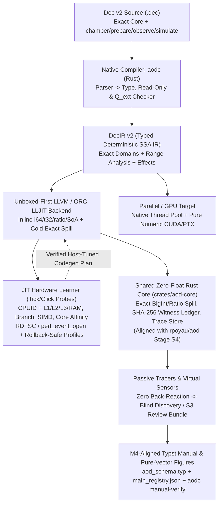

# `aod-dec` v2 Plan: Native Reference Engine Synchronized with `rpoyau/aod` (`S0`–`S4`)

> **Core Thesis:** `Dec` is the **native compiled reference engine and unbiased simulation laboratory for $\mathrm{A}\Omega\mathrm{D}$**. Setting up an experiment—such as opposing `3:3:6` structures entering a chamber observed by passive tracers and virtual sensors—must be concise, native `.dec` syntax with **zero hardcoded outcomes**, compiled by a real native compiler (`aodc`) with JIT CPU hardware learning, and strictly synchronized with `rpoyau/aod`'s governed `S0 → S4` roadmap.

---

## 1. Alignment with `rpoyau/aod`'s `S0 → S4` Master Plan

Grounded directly in [CORRECTED_S1_S4_MASTER_PLAN.md](file:///home/antigravity/rpoyau/aod-bundles/bundles/AOD_TYPST_S1_S4_PLAN_AF_REVIEW_BUNDLE_R01.zip) and [PLAN_AF_REVIEW.md](file:///home/antigravity/rpoyau/aod-bundles/bundles/AOD_TYPST_S1_S4_PLAN_AF_REVIEW_BUNDLE_R01.zip) (`R01`–`R07`):

| `rpoyau/aod` Stage | Current Status | Exact Interface with `rpoyau/aod-dec` v2 |
|---|---|---|
| **`S0` (M3 Stack: PRs `#43`, `#45`, `#46`)** | Built (`98ddfa0`, CI green) | Bind `SOURCE_BINDING.json` to M3 equations: consolidated Duon/Duad (`eq:duad-same-current`), derived wavelets (`eq:aod-wavelet-continuation`), overlap `id_return` dedup (`eq:wavelet-overlap-dedup`), cancellation retention (`eq:wavelet-cancellation-retention`), shed witness & recipient event lattice (`eq:shed-continuation-witness`, `eq:recipient-event-lattice`), cell measures/exact moments, and conditional SI/Cs-133/$\tau$ (`eq:m3-observation-map`–`eq:m3-cs133-tau-interface`). |
| **`S1a` & `S1b` (M4 Typst + 34/34 Vector Figures: PRs `#48`–`#50`)** | Built (`cea71a7`, `0/0/0` rasters, CI green) | Adopt `aod_schema.typ` macro conventions, bind `typst/lib/main_registry.json` for verified `#mainequation`/`#mainsection` links, enforce zero-raster pure-vector Typst figures (`0/0/0`), deterministic `--creation-timestamp 0` builds, and `aod-lint` Typst AST checks. |
| **`S2` (Canonical `manual/engine/` for Already-Authenticated Sectors)** | **Next in `aod`** | `aod` `S2` stays strictly free of experimental `aod-dec` imports (`R01`). Once `S2` publishes exact golden vectors (`--verify-all`), `aod-dec` verifies **100% bit-for-bit parity** on every already-authenticated Manual sector natively in compiled `.dec`! |
| **`S3` (Independent AF Authentication Gate for Experimental Models)** | **After `S2` in `aod`** | **`aod-dec` IS the unbiased experimental execution lab feeding `S3`:** explicit `chamber` / `prepare` / passive `observe` (`tracer`, `sensor`) / `simulate` experiments (e.g., `pp` opposing `3:3:6` chamber encounter) run raw in `.dec` with zero hardcoded outcomes and produce exact traces, falsifiers, and provenance bundles for `S3`'s independent AF review. Preserves `R01`/`R02` strictly (never relabels `1:2:10` `9/20` vs. `~23/50` as "float truncation"; never promotes `19/50` `_Exo` without proof; keeps `Q_ext` quarantined). |
| **`S4` (`std`-Rust Exact Core `crates/aod-core/`)** | **Planned in `aod`** | Build `aod-dec`'s exact integer/rational/ternary/witness runtime as a clean, zero-float Rust crate (`aod-core`) so **`aod-dec` and `aod` `S4` share one exact arithmetic core** instead of maintaining diverging Python/C++/Rust implementations! |

### Resulting Two-Track Execution Boundary
- **Track 1 (Unblocked Now — Zero `S2`/`S3` Dependency):** Native Rust `aodc` compiler + shared zero-float `aod-core` + unboxed LLVM/ORC JIT backend + real JIT CPU hardware learner + Dec v2 core & unbiased `chamber`/`prepare`/`observe`/`simulate`/`quarantine Q_ext` syntax (with pluggable `.dec` dynamics) + already-settled `S0`/`S1b` fixtures & M4 Typst manual setup.
- **Track 2 (Synced as `S2` & `S3` Land in `rpoyau/aod`):** Lock bit-for-bit parity against `S2`'s `manual/engine/` golden vectors, and run unbiased `.dec` chamber experiments (`3:3:6` opposing chamber encounter, electron–wire, double-slit, SPARC `G2/G3`) as reproducible candidate bundles for `S3`'s AF authentication gate — promoting canonical chamber dynamics into `aod-dec`'s Manual suite only once `S3` authenticates them.

---

## 2. Current State Diagnosis (`rpoyau/aod-dec` PRs `#1`–`#7`)

| Dimension | Current `aod-dec` (`codex/sparc-field-window`, PRs `#1`–`#7`) | Why v2 Replaces It |
|---|---|---|
| **Python vs. Compiler** | Frontend, LLVM/ORC host, batch/GPU drivers, and learner are ~2,600 LOC Python; applications live in **15,586 LOC** of `simulations/*.py` vs. only 10 tiny `.dec` files (~550 LOC, with unrolled Python-generated scalar dumps). | `Dec` must be the executable engine itself; simulations belong in compiled `.dec`, not Python orchestration. |
| **Boxed Codegen** | `native/compiler.py` lowers every literal/operator to boxed heap calls (`@dec_literal`, `@dec_binary`, `@dec_tick`) into `native/runtime.cpp`. | LLVM `-O2` cannot optimize opaque C ABI calls; PR `#1` showed **zero cost-inclusive speedup** on 7/7 workloads and rolled back to `-O0`. |
| **No Real JIT Hardware Learning** | `native/learning.py` only toggles `-O0` vs. `-O2` wall time on boxed calls. | No CPU microarchitecture discovery, no cache-tier/SIMD/branch/layout specialization, no `RDTSC`/`perf_event_open` counters. |
| **Syntax Gaps** | Core v1 rejects `struct`, `enum`, arrays, loops, `match`, tuples, modules, and AOD apparatus notation; duplicates parameter names on every function. | Cannot express a chamber, nested shells, passive tracers, virtual sensors, or even `dec/00..05`. |
| **Stale `aod` Binding** | Pinned to `AOD v40.01r10` and old `.tex` paths; PNG plots in companions. | Drifted from `S0` (M3 wavelets/recipient lattice/cell measures/SI) and `S1a`/`S1b` (M4 Typst primary + zero-raster vector figures). |

---

## 3. Unbiased Simulation Architecture (Zero Hardcoded Results)

```text
-----> 3:3:6 ((( )))   [        chamber        ]   ((( ))) 3:3:6 <-----
                           ▲          ▲
                      tracers    virtual sensors
                                      │
                        (strictly read-only trace)
                                      ▼
                     Blind Post-Run Motif / Current Discovery
                                      │
                        (separate metrology script)
                                      ▼
                   Quarantined Q_ext External Comparison
```

Dec v2 enforces **four strictly isolated layers at compile time**:

1. **`chamber` (Space, Boundaries & Pluggable Raw Engine):** declares topology (`Q4` graph, 3D/4D `CellGrid`, layered shells, walls) and the **explicitly declared raw D.E.C. update rule** (pluggable `.dec` module — never hidden assumptions).
2. **`prepare` (Initial Apparatus State ONLY):** declares incoming structures, shell depth, coordinates, directions, orientations, D.E.C. edge kernel/slide weights, and optional decoupled native reference clock (`biz^{TF}`). **Zero mention of expected outcomes** (no `TauCand`, no candidate list, no PDG/CODATA targets).
3. **`observe` (`tracer` & `sensor` — Compiler-Enforced Read-Only):**
   - `tracer`: passively logs committed events, hinges, returns, shedding emissions, and M3 wavelets/recipient stages in a region.
   - `sensor`: virtual boundary/shell sensor recording only what crosses, seats, or recloses at $\partial S$ ($\Phi_{\partial S}^D$, crossing/sweep/shedding, recipient stages, beats $\Delta\mathrm{bip}$, cadence vs. reference clock).
   - **Type-system firewall:** `tracer` and `sensor` bodies receive immutable views—mutating chamber state is a compile error (awareness/feedback experiments require an explicitly typed write-back coupling).
4. **Blind Post-Run Discovery & Separate `quarantine Q_ext` Metrology:**
   - Blind detectors run *after* `simulate` completes, inspecting only tracer/sensor streams to infer whatever `(p:q:L)` motifs, `yro` routes, Duons/Duads, wavelets, and currents actually emerged.
   - External constants (`MeV`, $\Delta\nu_{\mathrm{Cs}}$, CODATA/PDG targets) live in a **separate post-analysis script** inside `quarantine Q_ext` blocks; the compiler rejects external constants or targets anywhere in `chamber`, `prepare`, `observe`, or native $\mathbb{Z}/\mathbb{Q}$ discovery code.

### Target Dec v2 Syntax Example (Unbiased Two-`3:3:6` Chamber Setup)

```dec
use aod::chamber::{CellGrid, OpenWall}
use aod::dynamics::{PluggableDecEngine, Kernel}
use aod::observe::{Tracer, ShellSensor, ReferenceClock}

# 1. Chamber: topology, walls, and explicitly declared raw D.E.C. update rule
chamber CollisionChamber:
    space  = CellGrid(shape: [64, 16, 16], base: Q4)
    walls  = OpenWall(boundary: ∂space)
    engine = PluggableDecEngine(
        kernel: Kernel(weights: [1, 1, 4, 2], slide_on_dwell_block: [3, 3, 1]),
    )

# 2. Pure initial preparation: -----> 3:3:6 ((( )))  [ chamber ]  ((( ))) 3:3:6 <-----
prepare Opposing336 in CollisionChamber:
    inject left:  3:3:6, shells: 3, at: [8, 8, 8],  dir: +X, orient: +1t
    inject right: 3:3:6, shells: 3, at: [55, 8, 8], dir: -X, orient: -1t
    clock  ref:   1:2:6,            at: [2, 2, 2]

# 3. Passive tracers & virtual sensors (compiler-enforced read-only)
observe Opposing336:
    tracer core:
        region  = box([24..40, 4..12, 4..12])
        capture = [returns, hinges, shedding, wavelets, recipients]

    sensor ring_inner = ShellSensor(center: [32, 8, 8], radius: 4, window: 8)
    sensor ring_mid   = ShellSensor(center: [32, 8, 8], radius: 8, window: 12)
    sensor wall_exit  = ShellSensor(boundary: ∂CollisionChamber, window: 16)

# 4. Run natively compiled/JIT chamber and emit blind readout
Dec main() -> TraceArchive:
    let run = simulate Opposing336 for 10000 ticks
    emit blind_motif_spectrum(run.tracers.core)
    emit sensor_currents(run.sensors, ref_clock: run.clock)
    return run.archive
```

---

## 4. Target Compiler & Hardware-Learning Architecture



---

## 5. Phased Execution Plan

### Track 1 — Build Now (Aligned with `S0`, `S1a`, `S1b` & `S4`; Zero `S2`/`S3` Blocker)

#### Phase 0 — Clean Baseline, Regression Vectors & `aod` `S0`/`S1b` Binding
- Start a clean `v2` architecture branch off `main` (reusing PR `#1`–`#7` verified outputs as frozen regression test vectors without dragging forward the 15.5k LOC `simulations/*.py` stack).
- Append exact bindings for `rpoyau/aod` `S0` (`98ddfa0`) and `S1b` (`cea71a7`) to `SOURCE_BINDING.json` while preserving the historical `v40.01r10` entry untouched.
- Import read-only `typst/lib/main_registry.json` and `aod_schema.typ` macro definitions for Typst cross-reference verification.

#### Phase 1 — Shared Zero-Float `crates/aod-core` + Dec v2 Frontend & Apparatus DSL
- **`crates/aod-core` (Zero-Float Rust Exact Core — aligned with `aod` Stage `S4`):** exact arbitrary-precision `Int`, reduced `Ratio`, `t1`, packed 32-trit `t32`, `q4`, octal `addr8`, immutable `Trace`, `ReturnId`, `ClosureCert`, M3 `Wavelet` (`sigma_seat`, `sigma_role`, half-open overlap `id_return` dedup, cancellation history retention), `ShedWitness`, and `RecipientLattice`. Zero IEEE-754 floats anywhere in the native crate.
- **Dec v2 core syntax:** concise single-signature `Dec f(t32 a, t32 b) -> t32:` alongside multi-arm overload & literal/variant pattern dispatch, `struct`, `enum`, `[T; N]` / `vec[T]` / deterministic `map[K, V]`, tuples & destructuring, `if`/`elif`/`else`, `for`/`while`/`match`, `let` vs. `mut`, `use` modules, compact exact literals (`+1t`/`0t`/`-1t`, `1/3r`, `0o00`, `3:3:6`, `1:2:9_yro`, `(u, v]`), plus `--compat v1` for existing `examples/*.dec`.
- **First-class apparatus constructs:** `chamber`, `prepare`, `observe` (`tracer`, `sensor`), `simulate`, `quarantine Q_ext` — with compile-time enforcement of read-only observers, odd-length `_yro` route typing, and $\mathsf{Q}_{\mathrm{ext}}$ separation.

#### Phase 2 — Unboxed-First LLVM / ORC LLJIT Backend
- Single native binary `aodc` (`check | run | build | jit | probe-hw | bench | test | manual-verify`), removing Python from compilation, JIT, and simulation execution.
- **Unboxed-first LLVM lowering + cold exact spill:**
  - `t1`/`q4` → `i8`, `bool` → `i1`, `t32` → unboxed `i64` / packed 2-bit-per-trit with hardware `ctpop` & range checks.
  - `int` → inline `i64` with `llvm.sadd/ssub/smul.with.overflow`, cold-spilling to `aod-core` arbitrary precision only on overflow.
  - `ratio` → inline `{i64, i64}` with inline Stein binary GCD, cold-spilling only on overflow.
  - `struct`/`enum`/`[T; N]` → native LLVM aggregates / stack / SoA cell buffers; coarsened deterministic fuel accounting on loop/call boundaries instead of per-expression C ABI calls.
- In-process LLVM ORC LLJIT, native thread-pool spatial/batch execution, and LLVM NVPTX/PTX lowering from `DecIR v2` for pure numeric kernels.

#### Phase 3 — Real JIT Hardware Learner (Learning the Host CPU)
Replace `native/learning.py`'s `-O0`/`-O2` toggle with a native hardware-probing adaptive JIT grounded in AOD's tick/click probes and operative-self ($r_e = \Phi^{\mathrm{rec}} - \Phi^{\mathrm{ind}}$) retention:
1. **CPU Discovery & Tick/Click Micro-Probes (`aodc probe-hw`):**
   - Inspect CPUID/auxv (`AVX2`/`AVX-512`/`BMI2`/`POPCNT`/`NEON`, physical vs. SMT cores, NUMA, cache line size).
   - JIT-emit self-verifying micro-kernels measuring actual host characteristics:
     - **Memory-tier cliffs** (`Reg → L1d → L2 → L3 → RAM` latency & bandwidth steps),
     - **Exact arithmetic fast-path vs. spill crossover** (`i64` / packed `t32` / `{i64,i64}` vs. big-int spill),
     - **Branchless `cmov` vs. branching hinge-slide cost** across predictability regimes,
     - **SIMD width & AoS-vs-SoA layout throughput** (detecting AVX-512 downclocking),
     - **Physical-core vs. SMT scaling curve** for chamber tile partitioning.
2. **Hardware-Conditioned Codegen Specialization:** adapt representation fast-paths, branchless vs. branching lowering, L1/L2 tile sizes, AoS→SoA layout, SIMD width, unroll factor, and worker affinity per hot kernel.
3. **Exact Semantic Guard, Hardware Counters & Rollback-Safe Profiles:** verify exact return/stdout/witness equivalence before admitting any candidate; measure with `RDTSC` + optional Linux `perf_event_open` (cycles, IPC, L1d/LLC misses, branch misses); persist checksummed host-bound profiles promoted only on paired-bootstrap + held-out **net** gain (including compile + probe overhead) with automatic rollback.

#### Phase 4 — M4-Aligned Typst Manual & Already-Authenticated Fixtures (`S0`/`S1b`)
- Modularize `docs/manual/` using `aod_schema.typ`, verified `main_registry.json` cross-refs, pure-vector zero-raster plots (`0/0/0`), deterministic `--creation-timestamp 0` builds, `aod-lint`, and `aodc manual-verify` (checking positive runs + falsifying negative controls across AOT and JIT).
- Ship native `.dec` fixtures for already-authenticated `S0` sectors (`01_dec_ledger.dec`, `02_closure_wavelets.dec`, `03_short_window_boundary.dec`, `04_cell_measures_si.dec`) plus `05_chamber_sandbox.dec` exercising the `chamber`/`prepare`/`observe`/`tracer`/`ShellSensor` DSL on a clearly declared pluggable test engine.

---

### Track 2 — Synchronized with `rpoyau/aod` `S2` & `S3`

1. **`S2` Golden-Vector Parity Gate:** As soon as `rpoyau/aod` merges `S2` (`manual/engine/` `--verify-all`), run differential golden-vector checks confirming `aod-dec`'s compiled `.dec` Manual suite and `crates/aod-core` match every `S2` output bit-for-bit (preserving every `166/166` frozen digest, separate H-maser/Cs-fountain chains, and `Q_ext` quarantine).
2. **`S3` Experimental Chamber Lab (Unbiased Proposals for Independent AF Review):** Author clean, unbiased `.dec` chamber experiments (`-----> 3:3:6 ((( ))) [ chamber ] ((( ))) 3:3:6 <-----`, electron–wire, double-slit, SPARC `G2/G3`) with passive tracers, virtual shell sensors, blind motif discovery, explicit falsifiers, and separate `quarantine Q_ext` metrology scripts. Export compact, checksummed review bundles for `rpoyau/aod` Stage `S3`'s AF authentication gate—graduating any chamber engine into the canonical Manual suite **only** after `S3` authenticates it.

---

## 6. Incremental PR Sequence

| PR | Track / `aod` Sync | Deliverable & Exit Gate |
|---|---|---|
| **PR 1** | Track 1 (`S0`/`S1b`/`S4`) | `SOURCE_BINDING.json` update + shared zero-float `crates/aod-core` + Rust `aodc` frontend (Dec v2 core + `chamber`/`prepare`/`observe`/`simulate`/`quarantine Q_ext` type & firewall checker + `--compat v1`). |
| **PR 2** | Track 1 | Unboxed-first LLVM/ORC JIT backend (`i64`/`t32`/`ratio` inline fast-paths + cold `aod-core` spill + witness ledger) passing differential conformance against frozen v1 vectors with measured unboxed speedup. |
| **PR 3** | Track 1 (`S0`) | `stdlib/aod/` (`ledger`, `trace`, `wavelet`, `recipient_lattice`, `boundary`, `cells`, `metrology`) + native `.dec` Manual fixtures `01`–`05` verified against `rpoyau/aod` PR `#43`/`#45`/`#46` fixtures. |
| **PR 4** | Track 1 | Native JIT Hardware Learner (`aodc probe-hw`, memory-tier/arithmetic/branch/SIMD/threading micro-probes, `RDTSC`/`perf_event_open`, specialized codegen plans, rollback-safe retained profiles). |
| **PR 5** | Track 1 (`S1b`) | M4-aligned modular Typst manual (`aod_schema.typ`, `main_registry.json`, pure-vector `0/0/0` plots, `aodc manual-verify` positive + falsifying controls, `aod-lint`, CI). |
| **PR 6** | Track 2 (`S2` Parity) | Bit-for-bit golden-vector verification against `rpoyau/aod` `S2` `manual/engine/` across all authenticated Manual sectors + shared `crates/aod-core` export for `aod` `S4`. |
| **PR 7+** | Track 2 (`S3` Lab) | Unbiased `.dec` chamber experiments (`3:3:6` opposing encounter, electron–wire, double-slit, SPARC `G2/G3`) + passive tracers/virtual sensors + blind discovery + separate `Q_ext` metrology bundles feeding `rpoyau/aod` `S3` AF review. |

> **GitHub Note:** Attach `rpoyau/aod-dec` to this project's GitHub resources before pushing branches/PRs (it is currently public and cloned locally read-only).
